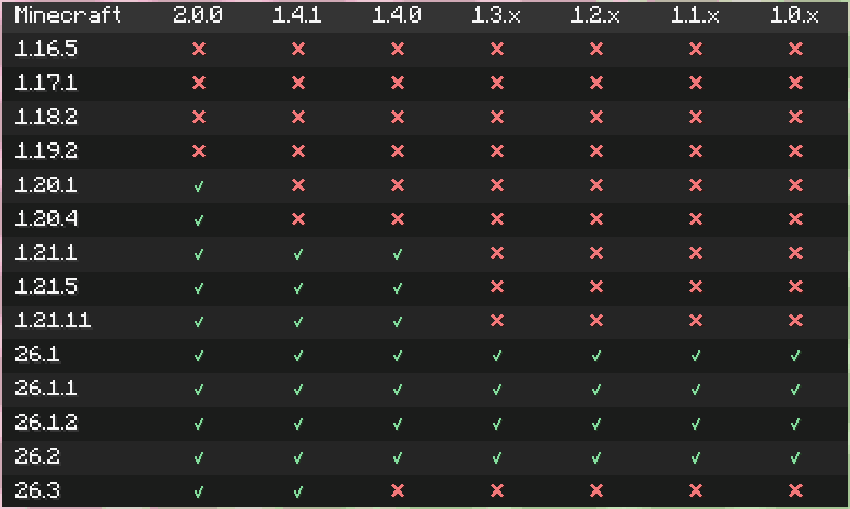

# What you Want to Find (WyWF)

A client-side Fabric mod for Minecraft 1.21.x and 26.x that turns the **Seed** field in the world-creation screen into a
natural-language search bar. Instead of a number, you describe the world you want
and the mod searches for a seed that matches — fully offline, without generating
chunks.

## Version compatibility



Choose matching releases of WyWF and DIY Lib for Minecraft 26.x.

| Minecraft               | WyWF and DIY Lib | Minimum Fabric Loader |
|-------------------------|-------------------------| --- |
| 26.1, 26.1.2, 26.2 26.3 | `26.x` and for 26.3 `26.3`  | 0.19.5 |

Build with the matching sibling checkout (`../diy-lib` or `../diy-lib-26.x`),
pass `-PdiyLibDir=<path>`, or publish the matching DIY Lib `0.1.0` artifact to
your local Maven repository with `publishToMavenLocal`.

## What it does

Type a description into the Seed field, for example:

```
village near warm ocean       mansion dark forest
desert temple in desert       near deep dark
spawn on sand                 some 4 village
never plains village          only desert pyramid
between 500 to 800 village   spawn on any solid
```

When you press **Create New World**, the mod:

1. Parses the text. If it contains no recognized keywords (or is a plain number),
   nothing happens and the world is created normally.
2. Otherwise it opens a search screen and looks for a seed whose world — around
   the origin `(0, 0)` — matches your description.
3. When a seed is found, it fills the Seed field with that number and creates the
   world as usual.

Keywords are recognized in **Russian and English**.

## Query language

A query is a list of keywords, each optionally preceded by a modifier:

| Modifier (EN / RU)                            | Meaning                                                                                                                                 |
|-----------------------------------------------|-----------------------------------------------------------------------------------------------------------------------------------------|
| *(none)*                                      | present within the default radius                                                                                                       |
| `near` / рядом, около, возле…                 | within ~200 blocks                                                                                                                      |
| `in` / в, на…                                 | within ~64 blocks (right where you spawn)                                                                                               |
| `far` / далеко, вдали…                        | far away (~500–1000 blocks)                                                                                                             |
| `some N` / несколько, много…                  | N or more structures nearby (if the number of structures is not specified (i.e., N structures), it searches for 2 structures by default |
| `only` / только, лишь, одна…                  | exactly one structure nearby (~500 blocks)                                                                                              |
| `between x1 to x2 (x1..x2)` / между, от…      | structure within a distance range                                                                                                       |
| `under` / под, снизу                          | the surface biome at that spot                                                                                                          |
| `no`, `not`, `without` `never` / нет, не, без | must **not** be present (~500-1000 blocks)                                                                                              |

Keywords fall into four categories:

- **Biomes** — `warm ocean`, `desert`, `dark forest`, `deep dark`, `lush caves`,
  `sulfur_caves` (near-only)…
- **Structures** — `village`, `mansion`, `desert temple`, `monument`,
  `ruined_portal` (incl. `ruined_portal_nether`), `nether fossil`…
- **Spawn blocks** — `grass`, `dirt`, `sand`, `stone`, `snow`, `podzol`,
  `mycelium`, `gravel`, or `any solid` block, prefixed by a trigger such as
  `spawn on`, `on the … block`, `на блоке …` (see below).
- **Objects** — `tree`, `water`, `lava` (recognized, but not searchable yet — ignored)

The dictionary lives in `KeywordDictionary` and holds many synonyms per keyword.
Multi-word keywords win over shorter ones (`dark forest` is matched as the
dark-forest biome, not `forest`).

### Spawn block

You can ask for the block the player ends up standing on at the world origin.
The query must contain a *trigger* (`spawn`, `on`, `на`, `блок`, `block`,
`onto`, `встань`, `стоять`) immediately followed by a block name:

```
spawn on sand
on the stone block
на блоке песок
на любых твёрдых блоках     (any solid block)
```

- `on` / `на` here mean *spawn on*, **not** the (removed) `ON` modifier.
- If the requested block can never be a world-origin surface block (e.g.
  `spawn on lava`), the term is ignored rather than failing the search.
- `any solid` always matches.
- The block is predicted from the biome at the origin chunk (the mod cannot run
  the vanilla voxel spawn finder offline on the client), so the prediction is
  approximate — beaches, rivers and snow layers may differ. It is accurate
  enough to reliably find e.g. desert (sand) or snowy (snow) spawns.

## How the search works

The search runs on a fixed thread pool (`SeedSearcher` + `SearchWorker`) and
never blocks the game thread. For every seed a `WorldContext` is built and
checked by `SeedValidator`:

- **Structures** are located from placement math
  (`getPotentialStructureChunk` + `applyAdditionalChunkRestrictions` +
  exclusion zones) — no chunk generation. Where a structure requires a
  specific biome, the biome at that spot is verified (via tags when
  available). Nether structures use a dedicated nether generator.
- **Biomes** are sampled from the vanilla `MultiNoiseBiomeSource`. When the
  native library is present, `CubiomesBridge` answers `getBiomeAt` up to
  ~50× faster; otherwise a reusable Java sampler is used. Cave biomes
  (`deep dark`, `lush caves`, `dripstone caves` and `sulfur_caves` with
  `near`) are sampled underground at `Y≈-50`.

### Search strategy

The seed space is split 48/16: an outer loop over the low 48-bit base and an
inner loop over the high 16 bits. Before scanning the 65 536 inner seeds, a
cheap placement-only prefilter (region-scan, no biome check) can skip the
whole group. Biome-only queries at origin may optionally use a linear walk
(`0, +1, -1, …`) for small memorable seeds. Every candidate is re-checked
exhaustively by `DeepVerifier` before it is shown.

### Fast sampling

Biome lookups need a `Climate.Sampler`. Building the full vanilla
`RandomState` per seed is expensive, so `ReusableClimateSampler` (and the
matching `ReusableTerrainSampler` for heights) builds the density-function
graph **once per thread** and, for each new seed, only re-creates the noise
leaves. Results are **bit-identical** to vanilla (verified by tests) while
being several times faster. When available, the native cubiomes path is even
faster.

## Configuration

With Mod Menu installed, open **Mods → What you Want to Find → Configure** to launch the constructor.
Its **Settings** tab contains the search and map options. The world creation screen also offers
**More → WyWF Settings** when Mod Menu is absent

Defaults (`SearchConfig`):

- Threads: `MAX` (all CPU cores, or `manualThreads` if set). Other modes:
  `HIGH` 75%, `AUTO` 65%, `ECONOMY` 25%.
- Structure search radius: 40 chunks. Biome check radius: 16 chunks,
  sampled every 4 chunks (configurable).
- Seed limit: 10M seeds, time limit: 30 min (either stops the search; set
  `infiniteSeeds` to ignore the seed limit). Candidate count: collects up to
  `8` matching seeds, then stops. For slow / rare queries the target **ramps
  down to `3` after 10 s** (`minCandidates`, `candidateRampDownSeconds`).
- Start position: randomized across the 48-bit space by default
  (`randomizeStart`), so a re-run explores different seeds.
- Search center: `SPAWN` (default) or `ORIGIN`.
- Native acceleration: `AUTO` (use DLL if present, otherwise Java),
  `NATIVE` (require DLL) or `CLASSIC` (Java-only).
- Query language: `EN` / `RU` / `AUTO` (both).

### Logging

Normal play logs almost nothing. The full per-search log (query echo,
worker lifecycle, progress, deep-verify verdicts) prints only with
the Java argument `-Dwywf.debug=true` — add it when reporting a bug
and attach the block from `===== Starting seed search =====` to
`Search finished`.

## Example: a seed found by WyWF

To show the mod in action, here is a real seed it discovered while running a
natural-language search (not a typed number), verified on 1.1.0:

> **Seed:** `3033784457675282057`
>
> - Query: `in village near mushroom`
> - Seeds checked: `1 665 924`
> - Search time: `62 552 ms` (~1 minute)
> - Candidates found: `3` (the search ramped down to 3 after 10 s, then stopped)

What you'll find in this world:
- You spawn on a **snowy beach**, right next to a **snowy village**.
- A **mushroom biome** lies in the middle of a `deep frozen ocean`, stretching
  from about `(-181, -159)` to `(-586, -862)`. It is made of **2 large islands**
  and **2–3 smaller ones** between them.


Copy-paste the seed:

```
3033784457675282057
```

## Limitations

- **Objects** (`tree`, `water`, `lava`) are recognized but not searched yet.
- Matches are checked around your chosen center (`SPAWN` by default). When
  `SPAWN` is used, the mod estimates the world spawn from the seed before
  checking — an approximation that `DeepVerifier` re-checks before showing.

## Building

### Prerequisites

- **JDK 25.** The mod is compiled against Java 25 (`sourceCompatibility` /
  `targetCompatibility = VERSION_25`, `options.release = 25`). Any JDK 25 works
  (e.g. Eclipse Temurin 25, Oracle, GraalVM). Set `JAVA_HOME` to it before
  building so Gradle uses the right compiler:

  ```bash
  # Linux / macOS
  export JAVA_HOME=/path/to/jdk-25

  # Windows (PowerShell)
  $env:JAVA_HOME = "C:\path\to\jdk-25"
  ```

- **No manual Gradle install needed.** The project ships the Gradle Wrapper
  (`gradlew` / `gradlew.bat`), which downloads the correct Gradle version
  automatically.
- **Internet access on the first build.** Fabric Loom downloads the branch's
  Minecraft, Fabric Loader and Fabric API build dependencies. Later builds can use `--offline` once dependencies are cached.

### Commands

Run the wrapper from the project root. On Windows use `gradlew.bat` instead of
`./gradlew`.

```bash
# Build the mod jar (compiles main + tests, runs the test suite)
./gradlew build

# Run the unit tests only (JUnit 5)
./gradlew test

# Launch a Minecraft client with the mod loaded (dev run)
./gradlew runClient

# Same with the full debug log enabled
./gradlew runClient -Pdebug

# Enable the DIY Lib console and UI debug screen
./gradlew runClient -Ddiylib.debug=true

# List all available tasks
./gradlew tasks

# Wipe the build output and caches for a clean rebuild
./gradlew clean
```

`runClient` uses the `client` run configuration defined in `build.gradle`
(Loom) and needs Fabric API, which is already declared as an `implementation`
dependency, so it works out of the box.

### Capture the compatibility table

Run these commands from the `26.3` checkout. 
The test screen opens on the Minecraft panorama and stays open until you leave it.
Its border uses a ten-second loop.

```bash
./gradlew runClient -I tools/compatibility-preview/run.gradle

./gradlew runClient -I tools/compatibility-preview/run.gradle -Dwywf.compatibility.gif=build/compatibility-recording/version-compatibility.gif
```

Relative output paths are resolved from the project directory.

### Output

The built mod jars are written to:

```
build/libs/wywf-2.0.0+26.3.jar
build/libs/wywf-2.0.0+26.x.jar
```

(the name is `<archives_base_name>-<mod_version>.jar`, taken from
`gradle.properties`). Build DIY Lib with its own Gradle wrapper to get `diylib-0.1.0+26.3.jar` or `diylib-0.1.0+26.x.jar` in its `build/libs/` directory.

### Build all three branches on Windows

Run the script from the `26.3` checkout with the `26.x` and `1.21.x` working
trees alongside it in `WyWF_26.x` and `WyWF_1.21.x`. Use `-Wywf26x` and `-Wywf121x` to supply other paths.

```powershell
powershell -NoProfile -File .\build-all\Build-All.ps1
```

Use `-Offline` once the dependencies are cached. The script checks the shared code
and native library across the 26 branches, runs the builds and tests, and copies the
verified JARs beside the script: three WyWF builds and two standalone DIY Lib
builds. Sync shared `src/main` changes across `26.3`
and `26.x`. Keep version-specific sources and resources in each branch's `src/mc*`.

### Troubleshooting

- **`invalid source release: 25` / `release version 25 not supported`** — your
  `JAVA_HOME` points at an older JDK. Point it at a JDK 25.
- **First build is slow / downloads a lot** — that is Loom fetching Minecraft
  and the mappings once; subsequent builds are much faster.
- **Outdated mappings / dependency caches** — run `./gradlew clean` and rebuild.

## Installation

1. Install Fabric Loader for your Minecraft version using the compatibility table above.
2. Install Fabric API, WyWF and DIY Lib as separate JARs in `mods/`.
3. Optionally install Mod Menu to open WyWF's settings and project links.
   Check the loader requirement of your Mod Menu version separately.

## Extending the dictionary

Add keywords/synonyms via `KeywordDictionary` and call `rebuildIndex()`:

```java
WYWFClient.dictionary().register(
    new KeywordDictionary.Entry("minecraft:my_biome",
        KeywordDictionary.Category.BIOME, "my biome"),
    "synonym one", "synonym two");
WYWFClient.dictionary().rebuildIndex();
```

## Credits

Fast native biome/structure math is based on
[cubiomes by Cubitect](https://github.com/Cubitect/cubiomes),
via the active fork by [xpple](https://github.com/xpple/cubiomes).

## License

Apache License 2.0 — see [LICENSE](LICENSE) and [NOTICE](NOTICE).
